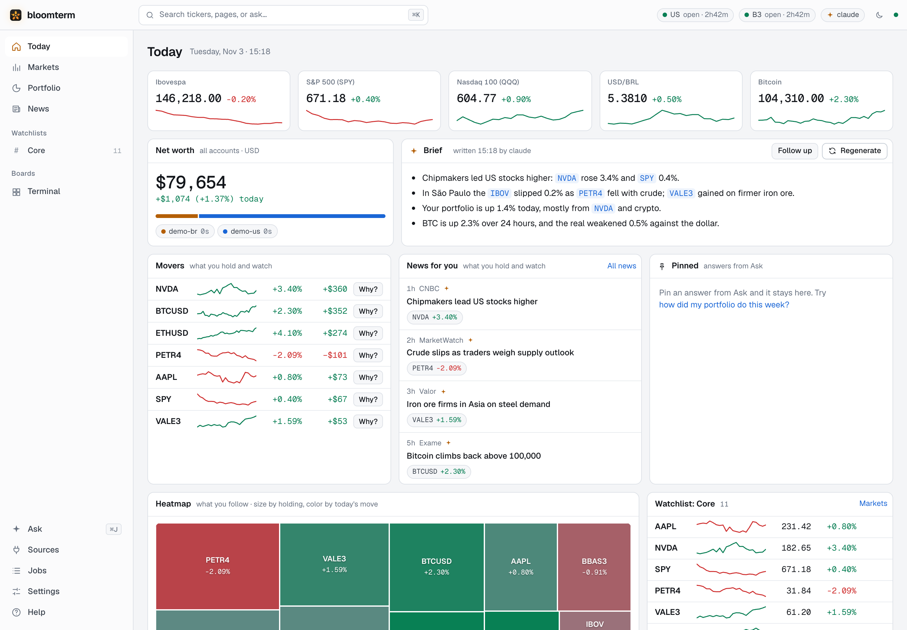

# bloomterm

A personal, keyboard-first market terminal for your Mac, built AI-first. It brings together
quotes, charts, news and filings for US and Brazilian (B3) markets, plus your own positions across
your accounts. It runs on your machine, and your data stays there. It runs your own Claude Code or
Codex for:
- **Ask**: a chat over bloomterm's data, beside any page. Answers show live tiles and charts, and
  you can pin them to Today.
- **The brief, "why it moved", and news**: a morning brief on a schedule; a sentence on why a
  mover moved; news from several outlets grouped into stories and tagged with tickers.
- **EVOLVE**: the agent builds and repairs the integrations themselves. It reverse-engineers a
  site's API through your signed-in browser and tests against the live site. Its work goes into
  `~/.bloomterm/integrations` once you review and approve it, without touching bloomterm itself.



<sub>Demo data: real tickers, made-up prices, positions and headlines (`make screenshot`).</sub>

[SPEC.md](SPEC.md) has the design: what it does, and why.

> **Status: early, and built for one person's use.** It runs on Apple silicon Macs only. Working
> now: the browser data layer, the daemon (bloomd) with its SQLite store, market data from free
> sources, news (RSS, CVM, SEC EDGAR, Alpaca), the web app, Ask, the brief and EVOLVE. No browser
> integration fetches real data yet: B3 is a draft, waiting for `EVOLVE b3`. Expect rough edges
> and breaking changes.

## Disclaimer

- **Not investment advice.** bloomterm shows data and what an AI agent says about it. Data from
  free sources can be late, incomplete or wrong, and agents make mistakes. Check before you act.
- **Your accounts, your terms.** bloomterm signs in to sites as you, with sessions you create in
  your own Chrome profile, and reads them. It's built to be read-only (see Safety rails below),
  but you are responsible for complying with each site's terms of service, and for what an
  integration you approve does.
- **No affiliation.** bloomterm isn't affiliated with, or endorsed by, any exchange, bank, broker,
  data provider or terminal vendor. Names of securities, institutions and products belong to their
  owners.
- **No warranty.** It's provided as is, under the [MIT License](LICENSE).

## Install

You need:
- A Mac with Apple silicon (M1 or later), on macOS 13 or later.
- Google Chrome.
- **Claude Code or Codex**, installed and signed in. bloomterm runs it on your own plan, so there
  are no model API keys:
  `npm i -g @anthropic-ai/claude-code && claude` (or `npm i -g @openai/codex && codex login`).

**The app.** Download [bloomterm.dmg](https://github.com/herval/bloomterm/releases/latest/download/bloomterm.dmg),
open it and drag bloomterm to Applications. It's signed and notarized, and updates itself from the
menu bar. The first time, Setup checks for Chrome and an agent CLI and says what's missing.

**From source.** You also need Node 22+ and pnpm (`corepack enable pnpm`):

```sh
git clone https://github.com/herval/bloomterm && cd bloomterm
make install            # checks the prerequisites, then pnpm install
make run                # builds the web app, starts bloomd, opens the UI signed in
```

`make app` builds the desktop app instead (needs [Rust](https://rustup.rs)); see below.

## Layout

```
apps/daemon         bloomd: localhost API + WebSocket, job runner, scheduler, market data, notifications
apps/web            the web app (React + Vite), served by bloomd
apps/cli            bt: a thin client of bloomd (plus `bt daemon`, `bt ui` and `bt mcp`)
apps/desktop        bloomterm.app (Tauri): runs bloomd, shows the web app, lives in the menu bar
packages/store      SQLite: sessions, job queue, schedules, holdings with provenance, chats, news, insights
packages/browser    browser host: profiles, parked Chrome, sessions, guards, adapter SDK
packages/integrations  every data source, one folder each (alpaca, brapi, coinbase, bcb, rss, cvm,
                    sec-edgar, b3: draft),
                    and EVOLVE.md, the routine for building and fixing them
packages/agent      runs Claude Code / Codex headless: detection, flags, event stream
packages/core       shared paths, dataset schemas, security keys, command grammar, quote/bar types
scripts             bundle.mjs (bloomd as one folder, for the app), fetch-node.sh (the app's Node)
```

## Development

Without Claude Code or Codex, bloomd still starts: market data and news work, and the Setup page
says what to install.

```sh
pnpm install            # needs Node 22+ and Google Chrome
pnpm test               # unit + headless Chrome against a local fake bank (incl. bloomd end to end)
pnpm test:chrome:stop   # quit the test Chrome (see below)
pnpm test:webkit        # the UI tests again in headless WebKit, the desktop app's engine
make screenshot         # the README's screenshot, on demo data
BLOOMTERM_HEADED_TESTS=1 pnpm vitest run --project headed   # shows real windows for ~20s
```

Or with make (`make` lists every target):

```sh
make install            # checks Node, pnpm, Chrome and an agent CLI, then pnpm install
make run                # builds the web app if it changed, starts bloomd, opens the UI signed in
make dev                # bloomd plus the web app with hot reload at http://localhost:5173
make app                # the desktop app (below)
```

The browser tests share one headless Chrome (`test/shared-chrome.ts`, profile in
`~/Library/Caches/bloomterm/test-chrome`). The first run starts it and later runs reuse it, so tests
never open or quit Chrome. It runs as a background-only process: no window, no Dock icon, no focus
changes. Each test profile is a separate context inside it (`ProfileConfig.cdpUrl`), with its
cookies saved to the profile dir on close.

## Running bloomd

```sh
pnpm bt daemon                  # foreground, logs to stderr; Ctrl-C stops it
pnpm bt daemon install          # LaunchAgent: starts now and at every login; logs in <home>/logs/bloomd.log
pnpm bt daemon install --print  # just show the plist
pnpm bt daemon uninstall
```

bloomd is the only process that opens the browser profiles. It listens on `127.0.0.1:4320` and
every request but `/api/health` needs the bearer token in `<home>/token` (created on first start,
0600). It also rejects requests whose `Host` header isn't this machine, so web pages can't reach it
via DNS rebinding. The LaunchAgent pins the Node binary you installed it with; re-run
`bt daemon install` after switching Node versions.

## The desktop app

`bloomterm.app` is bloomd and the web app in one Mac app. You still need your agent CLI and Google
Chrome; Node comes inside it. Build it on the Mac that will run it (Apple silicon):

```sh
make app            # needs Rust (https://rustup.rs) → apps/desktop/src-tauri/target/release/bundle/macos/bloomterm.app
make app-install    # the same, then copies it to /Applications
```

`make app` bundles bloomd into one folder (`scripts/bundle.mjs`), downloads the Node it runs on
(`scripts/fetch-node.sh`, checked against a pinned sha256) and builds the Tauri shell in
`apps/desktop`. That app is ad-hoc signed and has no updater, so it runs only on this Mac: run
`make app-install` again to update it. Releases, for other Macs, are below.

- **Opening it** starts bloomd and signs the window in. If a bloomd is already running for your data
  folder (`bt daemon`, or the LaunchAgent), it uses that one instead.
- **The first time**, if Claude Code or Codex isn't installed and signed in, or Chrome isn't found,
  it opens **Setup**: what's missing, the commands to run, and Check again. Until it's done, the
  top bar has a Finish setup chip. Market data and news work meanwhile (SPEC §8.8).
- **Closing the window** keeps bloomd running, with bloomterm in the menu bar: Open bloomterm, Ask…,
  Sources, Restart bloomd, Open at Login, Quit. Quit stops the bloomd the app started.
- **It restarts bloomd** when you choose Restart bloomd (after approving an EVOLVE run, say) and if
  it crashes. After three crashes in a minute it stops and shows bloomd's log.
- **Links** to other sites open in your browser, and **downloads** go to `~/Downloads`.
- It uses the same `~/.bloomterm`, Chrome profiles and agent CLI as a checkout, and finds `claude`
  or `codex` through your login shell's PATH. EVOLVE works the same: what it makes lives in
  `~/.bloomterm/integrations`, never in the app.
- `bt` comes with it: `ln -s /Applications/bloomterm.app/Contents/Resources/bundle/bt ~/.local/bin/bt`.

bloomd logs to `~/.bloomterm/logs/bloomd.log`. If you installed the LaunchAgent (`bt daemon
install`), the app uses that bloomd; `bt daemon uninstall` lets the app run its own. SPEC §8.7 has
the details.

### Releases

Official builds are on this repo's [Releases](https://github.com/herval/bloomterm/releases):
signed with a Developer ID, notarized by Apple, and updating themselves from the menu bar (Restart
to Update). [RELEASING.md](RELEASING.md) has how to cut one, or sign your own from a fork.

## The web app

```sh
pnpm build:web          # builds apps/web/dist; bloomd serves it at http://127.0.0.1:4320/
pnpm bt ui              # signs this browser in with a one-time code and opens the UI
pnpm bt ui --print      # just print the sign-in link (valid for 60s, works once)
```

Pages, each with its own URL:

| Page | What's on it |
|---|---|
| **Today** (`/`) | markets strip, net worth, the brief, movers with "Why?", news on what you follow, pinned answers, heatmap |
| **Markets** (`/markets`) | your watchlists as editable tables, with sparklines and a heatmap |
| **A security** (`/s/PETR4`) | chart (candles or line, SMA, news and filing markers), why it moved, your position, key stats, its news |
| **Portfolio**, **Sources**, **Jobs**, **Settings**, **Help** | positions; integrations, sign-ins and news feeds; job history; API keys and browser profiles; functions |
| **News** (`/news`) | stories grouped across outlets: top, for you, latest, filings, search |
| **Terminal** (`/terminal`) | the original four-panel board with its command line |

**⌘K** (Ctrl+K) finds anything: tickers or company names, pages, actions, and the terminal's
mnemonics (`PETR4 GP 1Y` opens PETR4's page on the 1Y chart). On a page, just start typing.
⌘↵ sends what you typed to Ask. **⌘J** opens Ask beside the page. It knows what you're
looking at. Phones get a tab bar.

It's light by default. Dark, or following macOS, is in Settings → Appearance, the sun/moon in the
top bar, or ⌘K ("Switch to dark theme"). The choice is saved per browser.

### The terminal board

Type anywhere and it goes to the command line: `[security] [FUNCTION] [args] <GO>` (Enter is GO).

| Type | Does |
|---|---|
| `PETR4 GP 1Y`, `AAPL OV`, `BTC` | price graph (5D … MAX, SMA50/200), overview, or the panel's function for that security |
| `W`, `W ADD MSFT`, `W DEL 3` | watchlist; `3` on its own opens row 3 in the linked panels |
| `SRC`, `JOBS`, `JOBS b3`, `PORT` | sources and sessions, job history, positions |
| `LOGIN b3` | bloomd opens the sign-in window; you sign in |
| `how is PETR4 doing?`, `PETR4 ASK why down`, `? W` | ASK: anything that isn't a command is a question for your agent |
| `EVOLVE b3`, `EVOLVE xp map the positions page` | your agent builds or fixes that integration, for you to approve |
| `SET` | API keys and bloomd status |
| `HELP` | everything else |

Keys: Esc goes back, ↑/↓ history, Tab completes, Ctrl+1…4 picks a panel, Ctrl+M maximizes it.
Drag the dividers between panels to resize them (double-click one to even it out).
Panels with the same link letter (click it to cycle A/B/C/off) follow each other's security. The
layout, watchlists and pins are kept in bloomd, so they're the same in every browser.

Securities use `ticker [exchange] sector` keys, and short forms work: `AAPL` → `AAPL US Equity`, `PETR4` →
`PETR4 BZ Equity`, `USDBRL` → `USDBRL Curncy`, `BTC` → `BTCUSD Crypto`, `IBOV` → `IBOV Index`.

### Market data

| Covers | Source | Key | Notes |
|---|---|---|---|
| US stocks, ETFs | Alpaca | key ID + secret (free) | real-time IEX quotes; history from SIP (all venues) |
| B3 stocks, IBOV | brapi | token (free) | ~30 min delay. Without a token only PETR4, VALE3, ITUB4 and MGLU3 answer, one request at a time |
| Crypto | Coinbase | none | real-time |
| USDBRL | BCB PTAX | none | the daily official fixing |

### News

| Source | What | Key |
|---|---|---|
| RSS | Valor, InfoMoney, Brazil Journal, Exame, Money Times, CNBC, MarketWatch | none |
| CVM (RAD) | B3 companies' material facts and notices | none |
| SEC EDGAR | filings (8-K, 10-Q, 10-K…) for the US stocks you follow | your contact email (`sec-contact`), which SEC asks for in the User-Agent |
| Alpaca | Benzinga news on US stocks | your Alpaca keys |

bloomd polls each on its own interval, tags items with tickers, and groups the same event from
several outlets into one story. When it has new items, your agent regroups them, titles the stories
and fixes the tags. News text is shown as text and goes to the agent as data, never as instructions.

Add keys in `SET`: bloomd saves them in the macOS Keychain (service `bloomterm`), and the UI only
ever sees whether each is set. `BLOOMTERM_SECRET_BRAPI` (etc.) overrides the Keychain for a run.
Yahoo and Nasdaq aren't used: Yahoo rate-limits scripts and Nasdaq turns away non-browser clients.

The UI talks only to bloomd. The page keeps bloomd's token in localStorage (no cookies: those are
shared across ports on 127.0.0.1), and bloomd refuses requests from other origins and sends a
strict CSP.

## AI: Ask, the brief, and EVOLVE

bloomd runs your agent CLI headless, isolated from your own setup: no plugins, hooks or MCP
servers of yours, and an allowlist of tools. `bt agent` shows which CLI it found and which one it
uses.

**Ask** answers from bloomterm's own data through `bt mcp`, a read-only MCP server with quotes,
history, the watchlist, the portfolio, news, sources and jobs. It streams into the Ask drawer (or an
ASK panel). Commands in its answers are clickable, securities it names show as live tiles, and
any answer can be pinned to Today. Follow-ups continue the same session. `bt ask "…"` does the
same from a shell. You can also give the tools to your own agent:
`claude mcp add bloomterm -- pnpm --dir <repo> bt mcp`.

**Spreadsheets in Ask.** Attach `.xlsx`, `.xls`, `.ods`, `.csv` or `.tsv` files (the clip, drag
and drop, or paste; up to 25 MB each) and ask about them: "total by category", "clean this up",
"import these positions". bloomd parses them, and the agent reads them only through Ask's own tools,
in that conversation: it can list, page and query sheets (exact sums and groups, Brazilian numbers
and dates understood), and write a `.csv` or `.xlsx` you download from the answer. Cells are treated
as data, never as instructions.

**Cards: the agent proposes, you click.**

- *Import*: positions or balances it read from a file show as a preview card with totals, and what
  they'd replace. **Import** saves them as their own snapshot (method `manual`) under that
  institution; a later fetch by its integration replaces it. Full account numbers are refused.
- *Connect an account*: "connect my Itaú account". If bloomterm has the integration, the card signs
  you in and fetches. If it uses an API key, it points to Settings. If not, **Open sign-in window**
  opens the bank's page in the finance profile, where you sign in yourself, and **Map it with
  EVOLVE** starts an EVOLVE run (below) that maps the site read-only. You review and approve it.

Nothing on a card happens until you click, and the agent never sees your password or codes.

**The brief** is written at 07:00 on weekdays, and whenever you press Regenerate. It covers the
markets, your movers, your portfolio (only with `share_portfolio`), the news on what you follow, and
anything that needs you. **Why?** on a mover asks your agent for a sentence on why it moved today. It
uses that day's news and the benchmark's move, and cites the stories it used.

**EVOLVE** (`EVOLVE <source> [goal]` or `bt evolve <source> [goal]`) is how integrations get
built and repaired. It never changes bloomterm itself: what it makes lives in your data folder.

1. bloomd makes a folder for the run, `<home>/evolve/<source>-<time>/`, with a copy of the
   integration (yours, or the built-in's, or nothing if it's new), the routine
   ([packages/integrations/EVOLVE.md](packages/integrations/EVOLVE.md)) as its CLAUDE.md and
   AGENTS.md, the SDK's sources, the built-ins as examples, and `./check`.
2. Your agent follows the routine. It looks for an official API first. Failing that, it finds the
   JSON calls the site's own pages make, using your HAR recordings and your signed-in browser
   profile. Then it writes the strategies, scrubbed fixtures and tests, runs `./check`, and runs
   `try_dataset` against the live site. It edits only the copy.
3. When it stops, bloomd runs the checks again: the copy loads the way bloomd will load it,
   typechecks against `@bloomterm/sdk`, passes its tests and has its README. The run shows them,
   with **Review diff** and **Approve**. You approve exactly the files the diff showed.
4. Approved, the copy goes into `<home>/integrations/<source>/` and runs from the next restart
   (**Restart bloomd**, or `bt restart`, when launchd or the desktop app runs it), in place of
   the built-in with the same name.

Only what you approved runs: bloomd keeps the hash of the files you approved, and if they change
(you edit one by hand, say), that integration stays off and the built-in, if any, runs instead,
until you approve it again in Settings or with `bt integrations approve <source>`. Every version
you approved is kept in `integrations/.history/`. `bt integrations` lists yours;
`bt integrations remove <source>` takes one out.

The agent never sees credentials: cookie, token and auth values are redacted before it gets
anything. Everything it does to a site goes through the mutation guard, so it can't write. Its
shell runs only `./check` and `ls` (Claude Code), or is sandboxed to the run's folder (Codex).
`./check` and `try_dataset` run its code as you, so treat it as you would any coding agent's tests.

A good first run, after signing in to B3:

```sh
pnpm bt record finance https://www.investidor.b3.com.br/   # click to your positions, close the tab
pnpm bt evolve b3 "map the positions export"
```

## Using `bt`

```sh
pnpm bt status                  # is bloomd up, what's running, session states
pnpm bt sources                 # sources, sessions, datasets, last fetch, next scheduled run
pnpm bt login b3                # bloomd opens the B3 sign-in; you sign in; it parks the window
pnpm bt probe b3                # still signed in?
pnpm bt run b3 positions        # fetch now (not built yet for B3: needs a recording)
pnpm bt jobs                    # recent jobs: what ran, when, why it failed
pnpm bt positions               # latest positions per source, with how and when they were fetched
pnpm bt ask "how is PETR4 doing?"                          # ASK from the shell (--chat <id> follows up)
pnpm bt evolve b3 "map the positions export"               # EVOLVE; `bt evolve` lists runs
pnpm bt agent                   # which agent CLI bloomterm found and uses
pnpm bt record finance https://www.investidor.b3.com.br/   # sign in, click around, close the tab → HAR
pnpm bt profile open web https://example.com               # browse a profile by hand, in plain Chrome (⌘Q when done)
pnpm bt doctor                  # launch each profile, park it, report
```

### What bloomd does on its own

- **Schedules.** Each dataset can declare a cron schedule (in its time zone), and `config.toml`
  can override or disable it. Slots are jittered ±10 min. Slots missed while the Mac slept
  collapse into one catch-up run when it wakes. A dataset that has never been fetched is fetched
  once right away. Draft adapters are never scheduled.
- **Signed out.** Nothing runs for a source that needs a sign-in or is blocked. You get a macOS
  notification, and the missed run goes first once you're back in.
- **Probes.** Signed-in sources are checked hourly (per adapter), so an expired session shows up
  before the next scheduled fetch needs it.
- **Restarts.** Jobs that were running go back in the queue. An interrupted sign-in is marked
  failed instead, so no window opens unless you ask.

### config.toml

Optional, in the data folder:

```toml
[daemon]
port = 4320
concurrency = 4

[notify]
macos = true

[agent]
cli = "auto"               # or "claude" / "codex"
# model = "…"              # the CLI's default if unset
web = true                 # web search for ASK; docs search and fetch for EVOLVE
share_portfolio = true     # false: ASK can't read holdings; EVOLVE sees body shapes, not values

[brief]
cron = "0 7 * * 1-5"       # local time, or set tz = "America/Sao_Paulo"
# enabled = false

[news]
ai = true                  # false: rules only, no agent grouping or tagging

[browser]
# chrome = "/Volumes/Apps/Google Chrome.app"   # only if it's somewhere bloomterm doesn't look

[profiles.finance]
mode = "parked"            # or "headless"

[schedules."b3.positions"]
cron = "0 9 * * 1-5"
tz = "America/Sao_Paulo"
# enabled = false
```

### Data on disk

Everything lives in `~/.bloomterm` (`BLOOMTERM_HOME` overrides):
`bloomterm.db` (SQLite), `profiles/`, `raw/` captures, `raw/_records/` HARs, `evolve/` runs,
`integrations/` (yours, with `.history/`), `files/` (what you attach in Ask), `agent/`, `token`,
`config.toml`.
These hold live sessions and account data. bloomd runs with umask 077 and forces the folder to
0700. Never sync or commit any of it.

## How the browser layer behaves on macOS

These were measured on an Apple silicon Mac (Chrome 155, two displays):

- **Parking minimizes.** macOS won't place a window fully off-screen; it keeps a ~40px strip visible.
  So a parked profile's window is moved to the far edge and minimized. A new job tab un-minimizes it
  (to the strip), and the host re-minimizes right away.
- **Launching steals focus.** When Chrome starts, it becomes the frontmost app. The runtime notes which
  app was in front before the launch and hands focus back after parking, and it does the same after a
  sign-in window closes. This uses System Events via `osascript`; without Automation permission it
  does nothing.
- **Session cookies survive restarts** only with `--restore-last-session` plus the "continue where you
  left off" pref. Both are on by default (`keepSessionCookies`).
- **Real Keychain.** Playwright normally passes `--use-mock-keychain`, which encrypts cookies with a
  public constant. bloomterm drops that flag, so profile cookies are encrypted with your
  "Chrome Safe Storage" key (`useSystemKeychain: false` reverts). The first real sign-in may show a
  Keychain prompt; tests use the mock keychain so they can never cause one.

## Safety rails (SPEC §6.8), all covered by tests

| Rail | What it does |
|---|---|
| Mutation guard | Blocks any non-GET request to the institution's origins unless it matches `allowWrites`. For GraphQL rules (`graphql: 'queries-only'`), it allows queries and blocks mutations, including inside batches; persisted operations are allowed only by name. WebSockets to the institution are refused unless listed. |
| Credential firewall | Adapter code that fills, types into, or reads a password or one-time-code field throws. |
| Click deny-list | Clicks on buttons named like buy/sell/transfer/pay/pix/resgatar… throw. |
| Service workers | Blocked, so every request goes through the guard. |

Adapters can't see the browser context or the routes, so they can't switch the guard off. These
rails stop mistakes in adapter code; they are not a sandbox, since `page.evaluate` can still read
the DOM. That's why only integrations you can read run: the built-ins in this repo, and yours in
`~/.bloomterm/integrations` exactly as you approved them; plus the one `try_dataset` exception, an
EVOLVE run's copy, run once with the guard on.

## Contributing

Issues and pull requests are welcome. bloomterm is built for one person's use first, so open an
issue before a large change. Before sending one:

```sh
pnpm typecheck && pnpm test:unit    # what CI runs
pnpm test                           # plus the browser tests, in a shared headless Chrome
```

Integrations for a specific bank or broker don't belong here: they hold how one site works and
change when it does. Build yours with EVOLVE; it lives in your data folder.

## Security

bloomterm holds live sessions for your financial accounts. Please report vulnerabilities
privately, as [SECURITY.md](SECURITY.md) explains, not in a public issue.

## License

[MIT](LICENSE). bloomterm includes third-party software under its own licenses; [NOTICE](NOTICE)
lists the notices they require.
